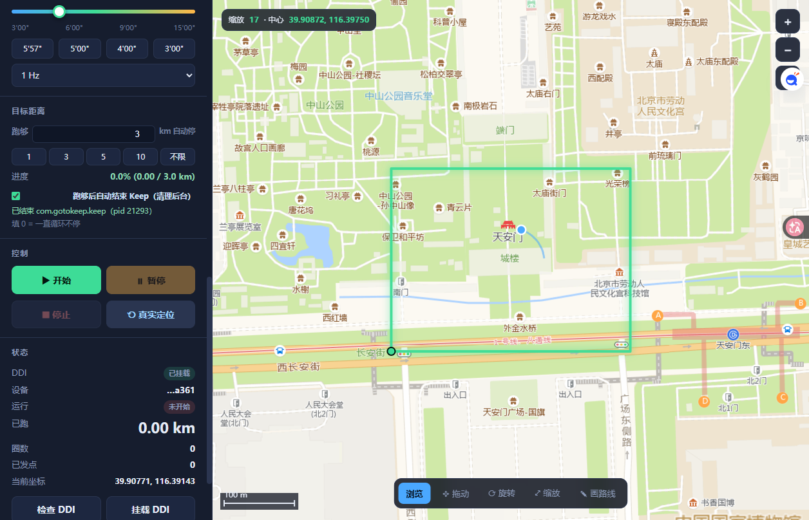
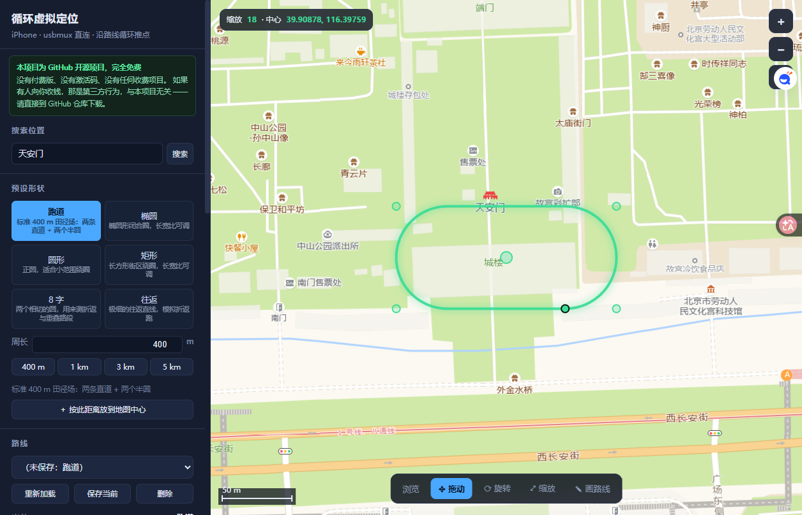

# 循环虚拟定位 · iOS（Loop GPS for iOS）

[](https://github.com/lm10090511/ios-keep-loop-gps/stargazers)
[](LICENSE)
[](https://www.python.org/)

**如果这个项目帮到了你，请点右上角的 ⭐ Star —— 这是对作者唯一的、也是最大的支持。**
（不收费、不收捐赠，Star 就是最好的回报，也能让更多人搜到它）

在 iPhone 上沿一条闭合路线**循环**移动定位，用于跑步类 App 的轨迹/里程测试。
纯 Python 标准库实现，**不需要越狱、不需要 root、不需要装 App**，只靠 USB 线连电脑。

> 只做定位注入。不修改任何 App、不注入进程、不 hook。

> **⚠️ 兼容性声明：本项目只在 iPhone 7 Plus（iOS 15.7.3）上做过实测。**
> 其它机型、其它 iOS 版本**都没有验证过**。理论上只要 DDI 能挂上、系统里有
> `com.apple.dt.simulatelocation` 服务就能用，但实际能不能跑、会不会崩、坐标准不准，
> 作者一概不知道。用别的机器请自己先小范围试，出问题欢迎提 Issue 附上机型与 iOS 版本。

---

## ⚠️ 关于收费：本项目完全免费

**这是 GitHub 上的开源项目，永久免费，任何人都没有权利向你收费。**

- 本项目采用 **GPL-3.0** 许可，源码全部公开，可自由使用、修改、分发。
- **没有任何付费版本、没有激活码、没有会员、没有"高级功能解锁"**。
- 如果你是在**付费**买到的、或者被人要求**扫码付款/充值**才能用，**你被骗了** ——
  请立刻停止付款，直接从这个仓库下载。
- 唯一的官方地址就是这个 GitHub 仓库。任何转载、搬运、二次打包的版本，
  只要向你收钱，都**与本项目无关**。

---

## ⭐ 觉得有用？求个 Star

这个项目是**一个人业余时间写的**，没有公司、没有赞助、没有任何收入来源。
如果它帮你跑通了 Keep、省下了折腾的时间，或者只是觉得这个思路有点意思：

| 你可以做的 | 有什么用 |
|---|---|
| **⭐ Star** | 最直接的支持。Star 数不给我带来一分钱，但会让仓库更容易被搜到，让下一个被 mock 定位折磨的人少走几天弯路 |
| **👀 Watch** | 修 bug、加新功能你会收到通知（选 Releases only 就不会被 Issue 打扰） |
| **🔀 Fork / 转发** | 很多人在安卓上撞了同一堵墙，转给他说不定就省他三天 |
| **🐛 提 Issue** | 报错截图 + 机型 + iOS 版本，比什么都管用；跑通了也欢迎来说一声，我好把机型补进兼容性列表 |

> **不用打钱。** 真要表达感谢，点个 Star 比发红包有用得多 ——
> 红包只能帮到我一个，Star 能帮到所有搜到这个问题的人。

---

## 它解决什么问题

用安卓模拟定位（`addTestProvider`）时，很多跑步 App 会主动丢弃带 mock 标记的点，
表现是「脚本在跑、地图不动、里程恒为 0」。原因是 App 内的定位 SDK 会检查
`Location.isFromMockProvider()` 并直接 `return`。

iPhone 这边是另一条路：iOS 的 `com.apple.dt.simulatelocation` 服务
（Xcode 的 Simulate Location 用的就是它）注入的点**不带 mock 标记**，
App 侧分辨不出来，所以里程、配速、轨迹都能正常累计。

本项目就是把这个服务单独拿出来用，再加一个「沿闭合路线循环」的引擎。

---

## 适用于 Keep

**这个项目最初就是为 Keep 写的**，主要用途是给 Keep 的跑步/骑行记录补轨迹样本。

- Keep 读的是系统定位，iOS 上注入的点不带 mock 标记，Keep 分辨不出来，
  所以轨迹、里程、配速都会按真实定位累计。
- 手机上不需要装任何插件、不需要越狱，Keep 照常从 App Store 装即可。
- 想让 Keep 记录某条路线：先在网页上把路线摆到那条路上（搜索地名 / 拖动 / 旋转 / 缩放），
  设好配速和目标距离，点「开始」，然后**在手机上打开 Keep 开始跑步**即可。

其它读系统定位的运动 App（悦跑圈、咕咚、Strava 等）原理上一样能用，
但**没有逐个验证过**，只保证 Keep 这条路是通的。

> 反过来，**安卓上不行**：安卓的定位注入点会被系统强制打上 mock 标记，
> 腾讯定位 SDK（Keep 用的就是它）会直接丢弃，里程恒为 0。详见下面的「安卓能用吗」。

---

## 前置条件

| 项 | 要求 |
|---|---|
| 电脑 | Windows 10/11（本项目在 Win11 上开发） |
| Python | 3.9+，**只用标准库**，无需 `pip install` |
| 手机 | iPhone，iOS 12+。**仅在 iPhone 7 Plus + iOS 15.7.3 上实测过**，其它机型/版本未验证 |
| 线 | 一根能传数据的 Lightning/USB-C 线 |
| 其它 | 电脑装了 **iTunes** 或 **Apple Mobile Device Support**（提供 usbmuxd） |

`usbmuxd` 是 Apple 的 USB 多路复用服务，随 iTunes/爱思助手一起装。
没有它脚本连不上手机（`--probe` 会明确报出来）。

---

## 界面长这样



左边控制、右边地图。地图可以滚轮缩放、拖拽平移，路线用绿线画出来，当前位置是蓝点。
左边「预设形状」选跑道/椭圆/圆形/矩形/8 字/往返，点一下就能放到地图上，再按住拖动到目标位置。
「目标距离」填个公里数，跑够自动停；底部那排是「浏览 / 拖动 / 旋转 / 缩放 / 画路线」五种操作模式。

<details>
<summary>点开看侧栏上半部分（搜索位置 + 预设形状）</summary>



</details>

---

## 快速开始（网页版，推荐）

1. 双击 **`循环定位-网页版.bat`**（或在目录里 `py -3 -X utf8 web_gui.py`）。
2. 浏览器自动打开 <http://127.0.0.1:8765/>。
3. 手机插上，第一次会弹「要信任此电脑吗」→ 点**信任**并输密码。
4. 界面左上「检查 DDI」——如果显示未挂载，点一下会自动挂（见下节）。
5. 想换地方，用左上「**搜索位置**」直接搜（比如「天安门」「天河体育中心」），
   点结果地图就跳过去。
6. 选一条**预设形状**（跑道/椭圆/圆形/矩形/8 字/往返）→
   点 **＋ 放到地图中心** → 地图上出现一个绿色闭合圈，自动切到「拖动」，
   按住地图把圈拖到你要的位置（松手自动生效）。
7. （可选）在「**目标距离**」里填个公里数，跑够就自动停；填 0 = 一直循环。
   下面的「跑够后自动结束 Keep（清理后台）」默认勾着，跑够时会替你结束 Keep 的进程。
8. 拖配速滑杆，点 **▶ 开始**。

界面上能做的事：地图上看路线/轨迹、鼠标滚轮缩放、拖拽平移、**按地名搜索跳转**、
**六种预设形状一键生成**、**拖动 / 旋转 / 缩放 / 手画** 四种改路线方式、保存/删除路线、
滑杆改配速（**跑着改也不会跳回起点**）、**设定目标距离跑够自动停**、
**跑够后自动结束 Keep（清理后台）**、暂停/继续/停止、一键恢复真实定位。

底部那排模式按钮是改路线的四种手法：

| 按钮 | 怎么用 |
|---|---|
| **浏览** | 默认。拖地图 = 平移视野，滚轮 = 缩放。 |
| **✥ 拖动** | 按住地图任意位置拖，整条路线跟着平移，松手生效。 |
| **⟳ 旋转** | 按住地图绕路线中心画弧，整条路线跟着转，松手生效。提示会显示转了多少度。 |
| **⤢ 缩放** | 按住往外拖 = 放大，往里拖 = 缩小（0.15×–8×），松手生效。 |
| **✎ 画路线** | 在地图上逐个点，双击结束连成闭合环，右键撤销上一个点。想画不规则形状时用。 |

> 预设形状的周长是精确的（跑道 400 m 误差 < 0.1%），拖到哪个操场就是哪个操场，不用自己凑点。

### 按地名搜索

左上「搜索位置」输入地名（`天安门`、`广州塔`、`天河体育中心`…），回车或点「搜索」，
结果列表点一下就跳到那个位置。用的是百度地图的公开搜索接口，不需要 API key；
连不上时会提示「可以直接拖地图到目标位置」，不影响其它功能。

### 目标距离：跑够自动停

「目标距离」填一个公里数（或点 `1 / 3 / 5 / 10` 快捷按钮），跑到这个距离自动停，
右边实时显示百分比进度。填 `0` 或点「不限」= 一直循环不停。

停的位置就是路线上当时所在的位置，不会跳回起点。**再点「▶ 开始」会从零开始算新一轮里程**，
不用手动清空。

> 注意：里程是按配速 × 时间累加的（推点间隔 1 Hz 时每点 = 速度 × 1 秒），
> 所以「目标距离」到点的时间 ≈ 距离 ÷ 速度。比如 5'57"/km 跑 3 km 约 17.9 分钟。

### 跑够之后：自动结束 Keep（清理后台）

跑够目标距离后，程序不会把定位服务关掉 —— 一旦关掉，iPhone 会立刻恢复真实定位，
而 Keep 还在「运动中」，就会记下一条从终点瞬移回你真实位置的假轨迹。所以程序改成：

1. **定位冻结在终点**：继续按 1 Hz 推同一个坐标，Keep 里看到的是「停下来了」，
   里程不再增长，也不会跳走。状态栏显示「已跑够 · 定位冻结在终点」。
2. **自动结束 Keep**：勾选框默认开启（`跑够后自动结束 Keep（清理后台）`）。
   跑够时程序会通过 USB 让 iPhone 结束 Keep 的进程，效果等同你在后台把 Keep 划掉 ——
   Keep 会把这次跑步的记录保存下来并暂停。
3. **收尾**：回到 Keep 点「继续」就能看到这条记录（里程 = 你设的目标距离）。
   确认记录没问题后，回到网页点「停止」恢复真实定位。

> **为什么是「结束进程」而不是「点结束」**：未越狱的 iOS 没有给外部程序开放
> 「点击界面」的通道（`testmanagerd`、`axAuditDaemon`、`launchservices` 全是
> `InvalidService`），所以没法替你点那个「结束」按钮。能用的通道是 Instruments 的
> DTX 服务（`com.apple.instruments.remoteserver.DVTSecureSocketProxy`）里的
> `processcontrol`，它允许结束指定 pid —— 这就是「清理后台」的实现方式。
>
> 记录**可能**比目标距离少一点点：Keep 是按它自己收到的时间片积分里程的，
> 进程被结束时最后那一两秒可能没落盘。要更保险可以把目标距离设得比实际想跑的稍大，
> 或者关掉这个勾选框，改用「定位冻结在终点」+ 手动去手机上点结束。

关掉勾选框就回到纯手动模式：跑够后定位仍然冻结在终点，日志提示你去手机上结束跑步，
结束完回来点「停止」。

命令行也行：

```bash
py -3 -X utf8 ios_loop_gps.py --route example-tiananmen.json --speed 2.8 --hz 1
```

`--speed` 单位是 m/s（2.8 ≈ 5'57"/km），`--hz` 是每秒推几个点，`--loops 0` 表示无限循环。

单独结束某个 App 也可以（不推点，只清理后台）：

```bash
py -3 -X utf8 killapp.py --bundle com.gotokeep.keep    # 结束 Keep
py -3 -X utf8 killapp.py --list                        # 列出手机上正在跑的 App 和 pid
```

---

## 关键概念：DDI（最容易卡住的地方）

`com.apple.dt.simulatelocation` 这个服务**永远注册着**，所以 `StartService` 永远成功、
点包永远发得出去、**不会报任何错**。但真正消费坐标的是 `locationd` 里的
`DTLocationsimulation.dylib`，**只有 DDI（DeveloperDiskImage）挂载后才会被加载**。

DDI 没挂 → 点包进黑洞 → 脚本一切正常、手机地图一动不动。

判断方法：

```bash
py -3 -X utf8 check_ddi.py     # 退出码 0 = 已挂载，1 = 未挂载
```

自动挂载：

```bash
py -3 -X utf8 mount_ddi_auto.py
```

脚本会按这个顺序找镜像：

1. 本目录 `ddi/` 下的 `*.dmg` + 同名 `*.sig`（自己放）
2. 爱思助手缓存目录（装了爱思通常已经有现成的）
3. `--dmg 路径 --sig 路径` 手动指定

> **镜像不随仓库分发**（Apple 的 DDI 有版权，体积也大）。
> 最省事的办法：装一次[爱思助手](https://www.i4.cn/)，连上手机让它自己下好 DDI，
> 之后本脚本会自动去它的缓存目录里找。
>
> DDI 必须与 iOS 版本匹配：iOS 15.5–15.9 用 `ss_ios155`，15.4 用 `ss_ios154`，以此类推。

挂载时 **`ImageType` 必须写 `"Developer"`**，不是 `"DeveloperDiskImage"`
（写错会得到 `Unsupported disk image type`）。这个坑在 `mount_ddi_auto.py` 里已经处理好。

---

## 坐标系：第二个大坑

高德/腾讯地图上量出来的经纬度是 **GCJ-02**（火星坐标），
iPhone 的 `simulatelocation` 要的是 **WGS-84**。国内两者差 400–600 米。

路线文件里写 `"_坐标系": "GCJ-02"`，程序会自动转换；不写则按 WGS-84 处理。

```json
{
  "_坐标系": "GCJ-02",
  "points": [[39.9075, 116.3955], [39.9075, 116.3995], [39.9099, 116.3995]]
}
```

网页版里拖路线时，显示用 GCJ-02（底图是高德瓦片），推送前自动转 WGS-84，不用管。

---

## 自己准备路线

**最简单：用预设形状**

左侧「预设形状」里选一个（每种形状自带标准周长，界面会显示），
点 **＋ 放到地图中心**，然后把生成的绿圈拖到目标位置就行。六种形状：

| 形状 | 默认周长 | 用途 |
|---|---|---|
| 跑道 | 400 m | 标准 400 m 田径场（两条直道 + 两个半圆），周长误差 < 0.1% |
| 椭圆 | 1000 m | 一般椭圆形闭合圈，长宽比可调 |
| 圆形 | 800 m | 正圆，适合小范围绕圈 |
| 矩形 | 1200 m | 长方形街区绕圈，长宽比可调 |
| 8 字 | 1000 m | 两个相切圆，用来测折返与重叠路段 |
| 往返 | 800 m | 极细的往返直线，模拟折返跑 |

想要精确的跑道尺寸就选「跑道」，生成的包围盒是 157.9 m × 73.6 m，与标准田径场一致。
大小不合适不用重新生成 —— 用底部的「⤢ 缩放」按住地图往外/往里拖即可（0.15×–8×）。

生成之后位置/朝向/大小不对，不用重新生成，直接用底部模式按钮调：

- **✥ 拖动** —— 平移到别处（比如从地图中心拖到某个操场）
- **⟳ 旋转** —— 按住绕中心转，转到跟跑道同向
- **⤢ 缩放** —— 按住往外/往里拖，放大缩小（0.15×–8×）
- **✎ 画路线** —— 想画不规则形状时手点，双击结束、右键撤销

**切换路线**：左上「路线」下拉框**选中即加载**，不用再点「重新加载」。
下拉里既列 `example-*.json` 这类示例，也列你自己「保存当前」过的 `route-*.json`。
选到「（未保存：xxx）」说明当前是刚生成/刚拖过还没存盘的路线，点「保存当前」起个名就进列表了。

**其它办法：**

1. **改示例 JSON**：`example-tiananmen.json` 里的 `points` 换成你的坐标。
2. **从 GPX 导入**：`ios_loop_gps.py --route xxx.gpx`（支持 `trkpt`/`rtept`/`wpt`）。
3. **命令行生成**：`presets.make_points("track", lat, lon, 400)`。

坐标怎么取：高德地图网页版右键「这是哪儿」→ 复制坐标，那就是 GCJ-02，直接填。

---

## 文件说明

| 文件 | 作用 |
|---|---|
| `web_gui.py` + `web_ui.html` | 网页版界面（推荐） |
| `gps_gui.py` | tkinter 桌面界面（离线备选，需要 Pillow 才能看卫星图） |
| `ios_loop_gps.py` | 核心：usbmux / lockdown / 推点 / 循环引擎，也可单独当命令行用 |
| `presets.py` | 预设形状生成（跑道/椭圆/圆形/矩形/8 字/往返），纯标准库 |
| `geosearch.py` | 按地名搜索坐标（百度公开接口 + BD09 墨卡托→GCJ-02），纯标准库 |
| `killapp.py` | 通过 DTX / `processcontrol` 结束手机上指定的 App（跑够后清理后台用），纯标准库 |
| `runner.py` | 推点线程，两套界面共用 |
| `coord.py` | GCJ-02 ↔ WGS-84 |
| `mount_ddi_auto.py` | 自动挂 DDI |
| `check_ddi.py` | 检查 DDI 挂载状态 |
| `recover.py` | 把手机恢复成真实定位 |
| `to_wgs.py` | 把 GCJ-02 路线文件转成 WGS-84 |
| `ios_loop_wizard.py` | 命令行向导（不想用界面时） |

---

## 常见问题

| 现象 | 原因 / 处理 |
|---|---|
| `--probe` 报「没有发现 iOS 设备」 | 没插线 / 没信任 / 没装 iTunes 或 Apple Mobile Device Support |
| 脚本在跑，但手机地图不动 | **DDI 没挂载**，跑 `check_ddi.py` 确认，再 `mount_ddi_auto.py` |
| 位置偏了 400–600 米 | 坐标系搞错，路线文件加 `"_坐标系": "GCJ-02"` |
| 手机彻底没有定位了 | 跑 `recover.py`；还不行就拔线 → 设置 → 通用 → 传输或还原 → **还原位置与隐私** → 重启 |
| 定位在乱闪 | 开了两个进程同时推点，先全部停掉再启一个（`web_gui.py` 有单实例保护） |
| 跑够后 Keep 里里程比目标距离少一点 | Keep 按自己收到的时间片积分，结束进程时最后 1–2 秒可能没落盘；把目标距离设稍大，或关掉「自动结束 Keep」改手动结束 |
| 停掉脚本后过一会自己回到真实位置 | 正常。iOS 会定时校准，脚本停了你就是真实位置 |
| `adb`/安卓那套能用吗 | 见下节 |

---

## 安卓能用吗

**开箱即用：不能。** 原因不是懒得做，是 Android 框架和 App 两边都在拦。

### 为什么拦得住

Android 框架对 `LocationManager.addTestProvider()` 注入的点**强制打 mock 标记**，
App 层拿不掉。而跑步类 App 普遍会检查这个标记：

```java
// 腾讯定位 SDK 里的真实代码（反编译自 Keep 9.0.10 的 classes10.dex）
if ("gps".equals(p2.getProvider())) {
    if (0x11 < Build.VERSION.SDK_INT && p2.isFromMockProvider()) {
        return;   // 带 mock 标记的 GPS 点，直接丢弃，连上报都不做
    }
    ...
}
```

于是出现很迷惑的现象：地图能跟着跳，但**里程和配速一直是 0** —— 因为地图用定位画点，
里程统计用的是被过滤后剩下的点（一个都没有）。

iOS 没有这个问题：`com.apple.dt.simulatelocation` 注入的点不带 mock 标记，
系统层面的 `isFromMockProvider` 也不会为真。

### 安卓 root 方案（未实测，自行验证）

> ⚠️ **下面这套我们没有在真机上跑通过。** 我们只在安卓模拟器里试过，失败了 ——
> 模拟器是 x86_64，Keep 只有 arm64 库，跑在 `libnb` 翻译层上，frida 一注入就 segfault。
> 真机是原生 arm64，理论上可行，但**你需要自己验证**。
>
> 另外：多数国产机型官方不解锁 BL，基本没戏。能 root 的多是开发版系统、一加、Pixel 这类。

前提：手机已 root（Magisk / KernelSU），且能跑 `frida-server`。

**第 1 步：把 frida-server 推上去**

```bash
# 从 https://github.com/frida/frida/releases 下对应架构的 frida-server
# arm64 机型用 frida-server-<版本>-android-arm64.xz
adb push frida-server /data/local/tmp/
adb shell "su -c 'chmod 755 /data/local/tmp/frida-server'"
adb shell "su -c '/data/local/tmp/frida-server -l 0.0.0.0:27042 &'"
adb forward tcp:27042 tcp:27042
```

**版本注意**：必须用 **frida 16.x**。frida 17 移除了内置 Java bridge，
脚本里 `Java.perform()` 会直接报 `ReferenceError: Java is not defined`。

**第 2 步：hook 掉 mock 检查**

保存为 `hook_android.js`：

```javascript
// 只 patch 返回 boolean 的重载，否则会报
// "Implementation for b expected return value compatible with void"
function patchAll(cls, name, fn, onlyBoolean) {
    try {
        var C = Java.use(cls);
        var ovs = C[name].overloads;
        var n = 0;
        for (var i = 0; i < ovs.length; i++) {
            var o = ovs[i];
            if (onlyBoolean && o.returnType.type !== 'boolean') continue;
            o.implementation = fn;
            n++;
        }
        if (n) console.log('[hook] ' + cls + '.' + name + ' x' + n);
    } catch (e) {
        console.log('[skip] ' + cls + '.' + name + ' : ' + e);
    }
}

Java.performNow(function () {
    // 第一层：系统 API
    patchAll('android.location.Location', 'isFromMockProvider', function () { return false; }, true);
    patchAll('android.location.Location', 'isMock', function () { return false; }, true);
    patchAll('androidx.core.location.LocationCompat', 'isMock', function () { return false; }, true);

    // 第二层：腾讯定位 SDK 自己的字段/方法。
    // 这些类在 App 启动后才加载，所以要轮询重试。
    var tries = 0;
    var timer = setInterval(function () {
        tries++;
        var done = 0;
        try {
            patchAll('com.tencent.map.geolocation.TencentLocation', 'isMockGps',
                     function () { return false; }, true);
            done++;
        } catch (e) {}
        try {
            patchAll('c.t.m.g.m7', 'isMockGps', function () { return false; }, true);
            done++;
        } catch (e) {}
        try {
            // 腾讯 SDK 的 GPS 提供者过滤，返回 true 表示「这个点不要」
            patchAll('c.t.m.g.k7', 'b', function () { return false; }, true);
            done++;
        } catch (e) {}
        if (done >= 2 || tries > 30) clearInterval(timer);
    }, 2000);

    console.log('[hook] READY');
});
```

**第 3 步：注入**

```bash
pip install frida-tools
frida -H 127.0.0.1:27042 -f com.gotokeep.keep -l hook_android.js --no-pause
```

注入后 App 可能会崩（加固 + 反调试）。如果崩，换 `spawn` 模式或改用 LSPosed 模块
（把上面同样的逻辑写成一个 Xposed 模块，稳定性更好，但要会编译 APK）。

**第 4 步：让定位真的动**

hook 只解决「不被丢弃」，你还需要往系统里灌坐标。两个选择：

- 装 VirtualRun 之类的模拟定位 App，在开发者选项里选它作为「模拟位置信息应用」；
- 或者再写一个 frida 脚本直接调 `LocationManager.setTestProviderLocation()`。

这条路我们没走完，所以不提供成品脚本 —— 上面两段代码是**起点，不是答案**。

### 不 root 有没有办法

只有一条：**装旧版跑步 App**。2020 年之前的版本大多还没有 mock 检测。
但旧版可能连不上服务器、或者功能残缺，属于碰运气。

---

## 协议备忘

想自己实现的话，关键几点（都是逆向 `idm_other.dll` + 抓包验证出来的）：

**1. usbmux 帧头 16 字节**，小端：

```
[length:u32][version=1:u32][message_type:u32][tag:u32]
```

`message_type=8` 是 plist 请求。`PortNumber` 字段必须发 `htons(port)`，
否则连 62078 会被回 `Result Number=3`。

**2. 隧道内换成 4 字节大端长度 + plist**：

```
[length:u32 BE][XML plist]
```

这是最容易卡的地方：usbmux 用 16 字节帧头，隧道内却用 4 字节大端长度。
用错了设备收到第一个字节就 EOF，表现是「隧道能建、一发数据就断」。

**3. 推点报文**：

```
[8 字节 BE len(lat)][lat 字符串][4 字节 BE len(lon)][lon 字符串]
```

lat/lon 用 `%.9f` 格式化，总长 `len(lat)+len(lon)+12`。

**4. 恢复真实定位**：向同一服务发 4 字节 `00 00 00 01`。

**5. 服务连接寿命很短**（1.2–3.0 秒），必须「连上就发、断了重连」。
lockdown 会话可以长期复用，但**不要发 `StopService`**（会让整个会话作废）。

完整版见 [docs/protocol.md](docs/protocol.md)。

---

## 环境变量

| 变量 | 默认 | 说明 |
|---|---|---|
| `USBMUX_HOST` | `127.0.0.1` | usbmuxd 地址 |
| `USBMUX_PORT` | `27015` | usbmuxd 端口（Apple 官方是 27015，部分版本是 27016） |

---

## 已知限制

- **只在 iPhone 7 Plus（iOS 15.7.3）+ Windows 11 上实测过。** 其它 iPhone 机型、
  其它 iOS 版本理论可行，但完全没验证过；DDI 版本要对上，否则挂不上。
- iOS 17 之后 DDI 机制有变化，需要挂载后额外推 dylib，本项目没做（`mount_ddi_auto.py`
  里会提示 `Unsupported`）。
- 一次只能连一台手机（usbmux 第一个匹配的设备）。
- 服务连接寿命只有 1–3 秒，所以每 1–2 秒要重建一次服务 socket（会看到日志里
  「重建连接 N 次」，正常）。

---

## 免责声明

仅供**自己账号的跑步数据测试**、App 开发调试、自动化测试使用。

用它去刷榜、代跑、伪造运动记录骗取活动奖励，属于违反平台规则甚至欺诈，
后果自负。作者不对任何滥用行为负责。

定位注入本身会让手机上报假位置，注意别在需要真实定位的场景（导航、打车、紧急呼叫）
下开着它。

---

## 许可与收费

**GPL-3.0**，见 [LICENSE](LICENSE)。

本项目**永久免费、开源**：

- 源码全公开，可自由使用、修改、分发（遵守 GPL-3.0 即可）。
- **没有付费版、没有激活码、没有会员、没有捐赠要求**。
- 任何人以本项目名义向你收费，都是**第三方行为，与本项目无关** —— 别付，直接来这里下载。
- 唯一官方地址：本 GitHub 仓库。

---

## 最后

如果这个仓库帮你解决了问题，**点个 ⭐ Star 再走**吧。

这是作者唯一会看、也唯一想要的回报 —— 没有广告、没有打赏码、没有"赞助解锁"，
只有一个小星星。它能让更多人搜到这个项目，也能让作者知道这东西真有人用。

- ⭐ **Star** —— 觉得有用就点，不用客气
- 👀 **Watch → Releases only** —— 有新版本时收到通知
- 🔀 **Fork / 分享** —— 转给还在安卓上撞墙的朋友
- 🐛 **Issue** —— 报 bug、报成功案例（附机型 + iOS 版本），都欢迎

谢谢。

